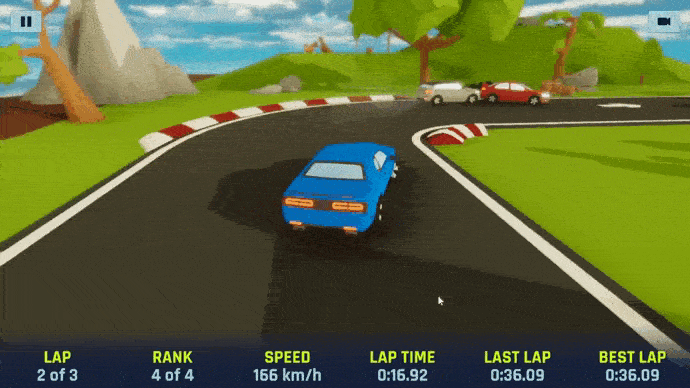

# Burnout Rush

Burnout Rush is a 3D arcade racing game built in **Unity with C#**. You pick a car and a track, then race AI opponents over several laps, or play split-keyboard two-player against a friend. It placed **2nd in the 3rd-year B.Tech project evaluation at SAITM, Gurugram**.

## Features (from the code)

- **Car physics:** Rigidbody car with WheelColliders and a tuned centre of mass (`CarController`, `Wheel`).
- **Drifting:** wheel slip is measured per wheel. Drifts leave skid marks drawn as a dynamic mesh, with tyre smoke and drift sound (`DriftController`, `Wheel`).
- **AI opponents:** robot cars follow track waypoints, with Easy / Normal / Hard difficulty (`TrackWaypoints`, `Player`).
- **Race modes:** Classic, Escape, Survival, Infection (an infected car spreads to others on contact) and Special (`Menu.RaceModes`).
- **Game types:** Play, Quick Race 1P and Quick Race 2P (local split controls, separate camera and HUD per player).
- **5 tracks:** Rural, Arctic, Desert, Urban and Moon (`Level-01` to `Level-05`).
- **Laps and timing:** 1 to 10 laps, checkpoints, current, last and best lap times, live race position, speedometer, countdown, results and leaderboard (`Player`, `UIController`).
- **Menus:** animated car and level selection (LeanTween), settings, pause, restart and quit. Music player with next/previous track and volume. Engine sound pitched to speed (`EngineSound`), and switchable camera views (`CameraFollow`).

## Controls

| Action | Player 1 | Player 2 (2P mode) |
|---|---|---|
| Accelerate / reverse | Up / Down arrows | W / S |
| Steer | Left / Right arrows | A / D |
| Confirm (menus, results) | Enter | |
| Back / pause | Esc | |

## Play it (Windows)

Download `BurnoutRush-Windows.zip` from [Releases](https://github.com/Deepanshu16125/Burnout-Rush/releases), unzip it and run `Burnout Rush.exe`.

## Open the project

1. Install **Unity 2020.3.6f1** (2020.3 LTS) through Unity Hub.
2. Clone this 
## Acknowledgement

Inspired by and partly based on Abhijeet Pitumbur's open-source racing project; extended with my own tracks, modes, AI and features.
